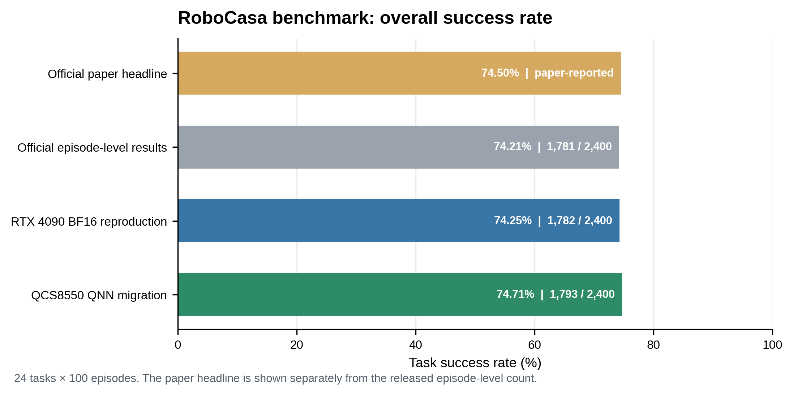
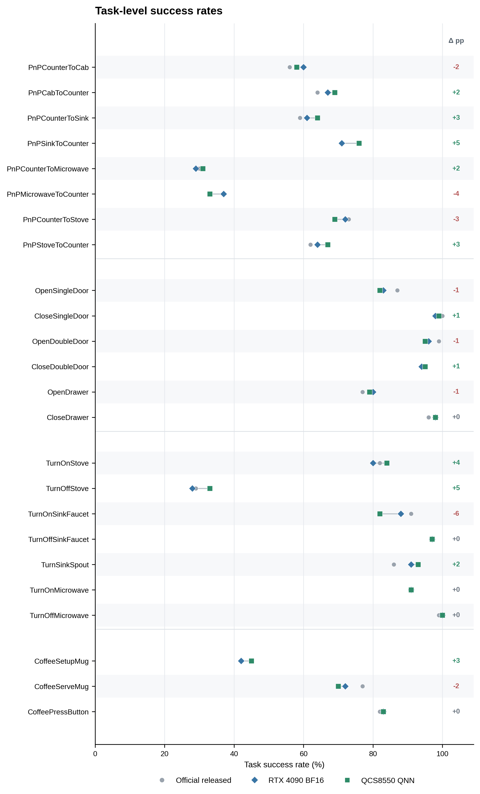
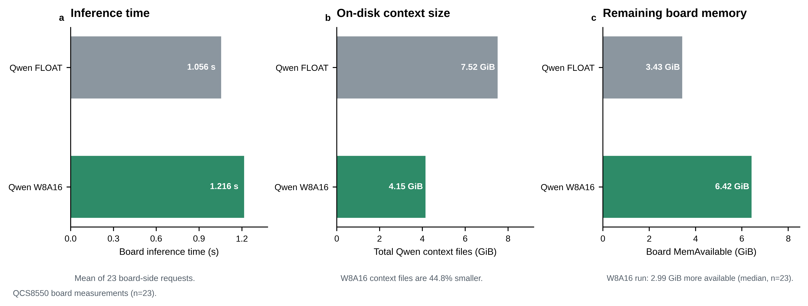
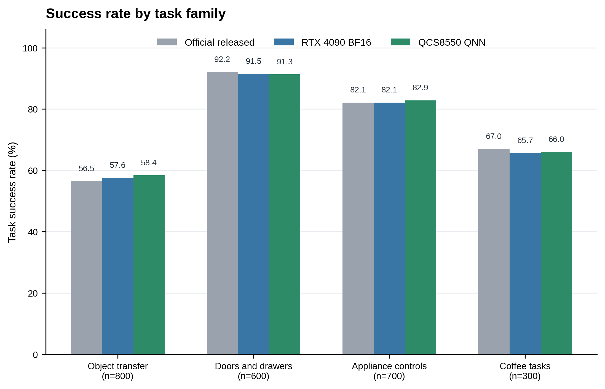

# XR-1 RoboCasa 模型在 QCS8550 上的量化迁移评测

## 摘要

我们将小米 XR-1 RoboCasa 模型迁移至 Qualcomm QCS8550，并在 RoboCasa v0.2 的 24 项任务上完成 2,400 集评测。QCS8550 QNN 达到 74.71%（1,793/2,400），RTX 4090 BF16 复现为 74.25%（1,782/2,400）；官方逐集记录为 74.21%（1,781/2,400），论文报告值为 74.5%。Qwen W8A16 将六个 context 文件总量从 7.52 GiB 降至 4.15 GiB；板端推理均值为 1.216 s，FLOAT QNN 为 1.056 s。

## 1. 研究问题

本文评估 XR-1 RoboCasa 模型迁移到 QCS8550 的 QNN/HTP 执行环境后的任务成功率。

我们比较官方论文报告值、官方逐集成绩、RTX 4090 BF16 复现和 QCS8550 原生推理。逐任务及任务类别结果以官方逐集记录为参照，该记录列出 24 项任务各自的成功集数。

## 2. 迁移方案

### 2.1 模型执行划分

XR-1 模型由视觉编码器、Qwen3-VL 语言视觉主干和 DiT 动作生成器组成。迁移版本将 Qwen 的 36 层划分为六个连续的 6 层计算图，以适配 QNN 的编译和板端执行方式。输入仍使用三路 256×256 图像和 60 维机器人状态，模型生成长度为 10、每步 60 维的动作序列。

Qwen 计算图采用 W8A16：权重使用 INT8，激活使用 INT16。注意力掩码的 Where 边界保留在量化算术之外，并保留权重量化路径，避免掩码运算与激活量化交界改变注意力语义。

### 2.2 数值稳定的 Gate 实现

Qwen 第 0、1、2 层的 Gate/SiLU 使用稳定形式重写。对于输入 \(x\)，令

\[
u=\exp(-|x|),\qquad r=\frac{u}{1+u},
\]

再按 \(x\) 的符号计算 sigmoid：

\[
\operatorname{sigmoid}(x)=
\begin{cases}
1-r,&x\ge 0,\\
r,&x<0,
\end{cases}
\qquad
\operatorname{SiLU}(x)=x\operatorname{sigmoid}(x).
\]

该写法将除法分母限制在 \([1,2]\)，避免直接计算大正数指数及大分母倒数。其余 Qwen 层不应用这项专门的 Gate 改写。

### 2.3 视觉与动作生成路径

视觉编码器采用 Patch-Gemm W8A16 路径。DiT 动作生成器保持 FLOAT ONNX 计算图，并在 QNN 上编译、链接，没有加入显式权重量化。整套迁移方案由 Qwen W8A16、视觉 Patch-Gemm W8A16 和 FLOAT DiT 组成。

板端目标为 QCS8550，运行在 HTP v73，使用 QAIRT 2.50。校准集由 24 个任务各取一个 seed 0 样本构成；固定请求验证另使用各任务 seed 100 样本。主要成功率评测采用每个任务 seed 0–99，因此包含校准所用的 seed 0 场景。

## 3. 评测设置

官方逐集参考、RTX 4090 BF16 复现和 QCS8550 QNN 评测均覆盖 24 项 RoboCasa v0.2 任务，每项 100 集，共 2,400 集；任务顺序和每项任务的 seed 范围均为 seed 0–99。指标为成功 episode 数除以总 episode 数。由于各任务样本数相同，整体成功率也等于 24 项任务成功率的算术平均。

4090 复现在两张 RTX 4090 上运行官方 BF16 模型，采用 FlashAttention 2、0.95 图像裁剪比例、模型请求随机种子 42 和长度为 10 的动作块；仿真侧使用 6 个 worker 和 2 个模型服务进程。板端版本通过 native QNN 推理服务接入 RoboCasa 仿真评测。

### 3.1 总体结果

图 1. 官方论文报告值单独列出；官方逐集成绩、4090 复现和 QCS8550 迁移均由 2,400 集结果汇总。

| 系统 | 成功数 / 总集数 | 总体成功率 |
|---|---:|---:|
| 官方论文报告 | — | 74.50% |
| 官方逐集成绩 | 1,781 / 2,400 | 74.21% |
| RTX 4090 BF16 复现 | 1,782 / 2,400 | 74.25% |
| QCS8550 QNN 混合精度迁移 | 1,793 / 2,400 | 74.71% |

4090 BF16 复现比官方逐集成绩多成功 1 集，相差 0.04 个百分点。QCS8550 比 4090 BF16 多成功 11 集（0.46 个百分点），比官方逐集成绩多成功 12 集（0.50 个百分点），比论文报告的 74.5% 高 0.21 个百分点。

### 3.2 逐任务成功率

图 2. 24 项任务的逐项结果；右侧标出 QCS8550 相对 4090 BF16 的百分点变化。

每项任务各运行 100 集，因此表中成功率同时对应成功集数。例如，58% 表示 100 集中成功 58 集。

| 任务 | 官方参考 | RTX 4090 BF16 | QCS8550 QNN | QCS8550 − 4090（百分点） |
|---|---:|---:|---:|---:|
| PnPCounterToCab | 56% | 60% | 58% | −2 |
| PnPCabToCounter | 64% | 67% | 69% | +2 |
| PnPCounterToSink | 59% | 61% | 64% | +3 |
| PnPSinkToCounter | 71% | 71% | 76% | +5 |
| PnPCounterToMicrowave | 30% | 29% | 31% | +2 |
| PnPMicrowaveToCounter | 37% | 37% | 33% | −4 |
| PnPCounterToStove | 73% | 72% | 69% | −3 |
| PnPStoveToCounter | 62% | 64% | 67% | +3 |
| OpenSingleDoor | 87% | 83% | 82% | −1 |
| CloseSingleDoor | 100% | 98% | 99% | +1 |
| OpenDoubleDoor | 99% | 96% | 95% | −1 |
| CloseDoubleDoor | 94% | 94% | 95% | +1 |
| OpenDrawer | 77% | 80% | 79% | −1 |
| CloseDrawer | 96% | 98% | 98% | 0 |
| TurnOnStove | 82% | 80% | 84% | +4 |
| TurnOffStove | 29% | 28% | 33% | +5 |
| TurnOnSinkFaucet | 91% | 88% | 82% | −6 |
| TurnOffSinkFaucet | 97% | 97% | 97% | 0 |
| TurnSinkSpout | 86% | 91% | 93% | +2 |
| CoffeeSetupMug | 42% | 42% | 45% | +3 |
| CoffeeServeMug | 77% | 72% | 70% | −2 |
| CoffeePressButton | 82% | 83% | 83% | 0 |
| TurnOnMicrowave | 91% | 91% | 91% | 0 |
| TurnOffMicrowave | 99% | 100% | 100% | 0 |
| **总体** | **74.21%** | **74.25%** | **74.71%** | **+0.46** |

### 3.3 推理时间、模型文件大小与板端剩余内存

在同一块 QCS8550 上，使用同一 checkpoint 的 23 条固定请求比较 Qwen FLOAT QNN 与 Qwen W8A16；视觉和 DiT 路径保持相同。推理时间取板端 QNN 服务测量值，统计 23 次请求的均值。板端剩余可用内存取每次请求后读取的 `/proc/meminfo` 中 `MemAvailable`，报告 23 次请求的中位数。

| 指标 | Qwen FLOAT QNN | Qwen W8A16 |
|---|---:|---:|
| 板端推理时间均值（n=23） | 1.056 s | 1.216 s |
| 六个 Qwen context 文件总量（磁盘） | 7.52 GiB | 4.15 GiB |
| 板端剩余可用内存 `MemAvailable` 中位数（n=23） | 3,513 MiB（3.43 GiB） | 6,574 MiB（6.42 GiB） |

W8A16 的 Qwen context 文件总量减少 44.8%。23 次请求后的 `MemAvailable` 中位数分别为 3,513 MiB 和 6,574 MiB，相差 **3,061 MiB（2.99 GiB）**。

图 4. (a) 23 次板端推理的平均时间；(b) Qwen context 磁盘大小；(c) 23 次请求后板端剩余可用内存 `MemAvailable` 的中位数。

## 4. 结果分析

### 4.1 4090 BF16 复现接近官方参考

4090 BF16 复现达到 74.25%，与官方参考结果 74.21% 相差 0.04 个百分点，仅多成功 1 集。两组逐 seed 结果中，2,193/2,400 集的成功或失败判定相同，整体复现了官方参考的任务水平。

### 4.2 QCS8550 保留了整体任务能力

QCS8550 总体成功率为 74.71%，比 RTX 4090 BF16 高 0.46 个百分点。逐任务比较中，QCS8550 有 11 项高于 4090、5 项持平、8 项较低。

将任务按操作类型汇总后，物体搬运为 58.38%（467/800），柜门与抽屉为 91.33%（548/600），家电与水龙头操作为 82.86%（580/700），咖啡操作为 66.00%（198/300）。

图 3. 按任务类别汇总的成功率；每组柱上方标出百分比，括号中为该类别 episode 数。

任务级变化较明显的项目包括 TurnOnSinkFaucet（88% 降至 82%）、PnPMicrowaveToCounter（37% 降至 33%）、TurnOffStove（28% 升至 33%）和 PnPSinkToCounter（71% 升至 76%）。

## 5. 结论

XR-1 RoboCasa 混合精度迁移在 QCS8550 上完成了 2,400 集评测，成功率为 74.71%，与 RTX 4090 BF16 复现（74.25%）和官方逐集成绩（74.21%）接近。Qwen W8A16 将 context 文件总量缩小 44.8%；板端推理均值为 1.216 s，FLOAT QNN 为 1.056 s。逐任务结果显示，各任务的变化方向并不一致。
